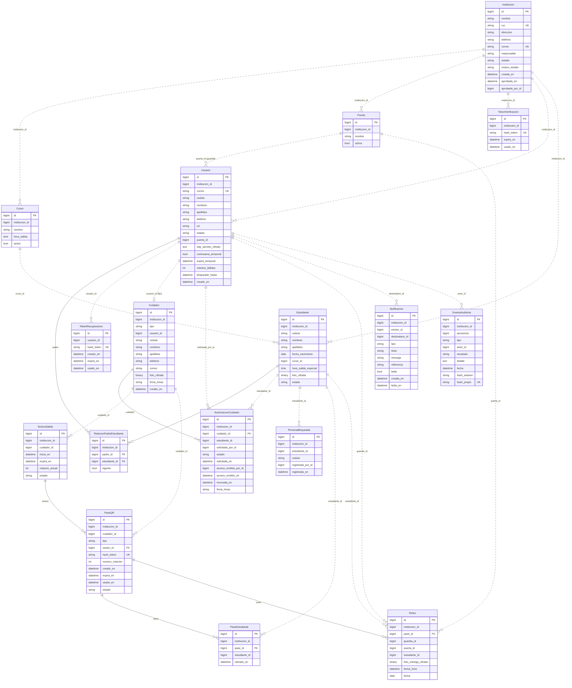

# Diagrama entidad-relación del sistema

Las 17 tablas de negocio de los 7 módulos del monolito.

- **Línea continua:** clave foránea real (solo dentro del mismo módulo).
- **Línea punteada:** referencia por id entre módulos, sin clave foránea (regla MM-03).
- Todas las tablas de un colegio llevan `institucion_id` (aislamiento por colegio). Para no saturar el diagrama solo se dibuja la línea en las tablas principales.
- Los **cinco roles** (Administrador del Sistema, Administrador Escolar, Padre, Guardia y Cuidador Fijo) se guardan en `Usuario`, diferenciados por el campo `rol`.
- `Cuidador` guarda a la persona que retira; si es fijo, `usuario_id` apunta a su cuenta en `Usuario`.
- `institucion_id = 0` en `EventoAuditoria` indica un evento global (sin institución).
- El módulo `chat` solo persiste las notificaciones; el envío en tiempo real va por WebSocket y push, sin tablas de mensajes.

| Módulo | Tablas |
|---|---|
| instituciones | Institucion, Curso, Puerta, TokenVerificacion |
| cuentas | Usuario, Estudiante, RelacionPadreEstudiante |
| autenticacion | TokenRecuperacion |
| cuidadores | Cuidador, AutorizacionCuidador, PersonaBloqueada |
| retiros | SesionSalida, PaseQR, PaseEstudiante, Retiro |
| chat | Notificacion |
| auditoria | EventoAuditoria |

