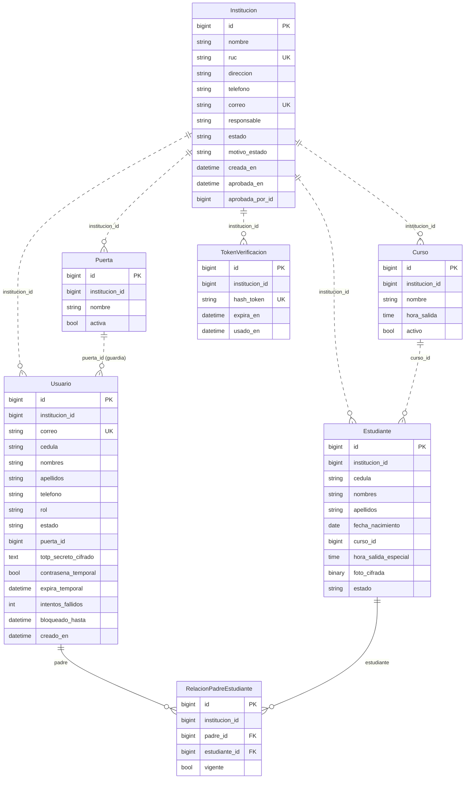

# Diagrama entidad-relación

Tablas del módulo `instituciones` y del módulo `cuentas`.

- **Línea continua:** clave foránea real (dentro del mismo módulo).
- **Línea punteada:** referencia por id entre módulos, sin clave foránea (regla MM-03).
- Casi todas las tablas llevan `institucion_id` (aislamiento por colegio); no se dibuja cada línea para no saturar el diagrama.

